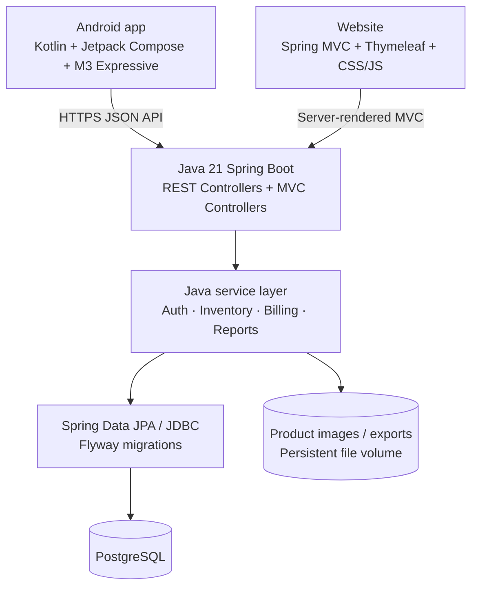

# SmartStock — Project Goals and Implementation Blueprint

> **Project:** SmartStock — Enterprise Inventory & Billing Management System  
> **Course:** Enterprise Web Application — UCS553 (2026–27 Odd Semester)  
> **Institution:** Thapar Institute of Engineering & Technology (TIET), Patiala  
> **Instructor:** Dr. Kanupriya  
> **Status:** Agreed technical direction; implementation pending  
> **Document updated:** 18 November 2026

## 1. Vision

Build **SmartStock**, a new, standalone, **Android-first enterprise inventory and billing system**. Deliver a native Android app as the primary product, a **Java web application** as a functional secondary client and demonstration fallback, and a shared **Java Spring Boot + PostgreSQL** backend.

**One-sentence success criterion:** A user can perform an authorized inventory or billing operation in the Android app and immediately see the correct, persisted result on the Java-powered website (and vice versa), with secure access, correct transactions, and consistent branding.

An earlier Node.js/Express + MySQL inventory app is used only as a feature reference (see `docs/reference-audit.md`); the product, code and branding are independent of it.

### Project team

| Member | Roll number |
| --- | --- |
| Ishant Mehndiratta | 1024030525 |
| Satyam Tiwari | 1024030088 |
| Anshaj | 1024030494 |
| Aayush Bindal | 1024030498 |

SmartStock is an independent **UCS553** project under **Dr. Kanupriya**.

## 2. Product goals (in priority order)

1. **Android-first:** Deliver a polished, genuinely native Android app using Kotlin, Jetpack Compose, and Material 3 Expressive. It must be the primary live demonstration.
2. **Java-first core:** Implement the HTTP API, security, business rules, transactions, persistence, and web server in **Java 21 + Spring Boot**. Use Kotlin primarily where Compose and Android-specific UI state benefit from it.
3. **Java website:** A **Spring MVC + Thymeleaf** browser client served by the same backend and database.
4. **Single source of truth:** Both clients use one authenticated backend and one PostgreSQL database. Never duplicate inventory or billing logic independently in the clients.
5. **Core scope first:** Roles, inventory management, checkout, discounts, alerts, order history, and analytics before enhancements.
6. **Reliable demonstration and deployment:** Run locally with Docker Compose and, when practical, deploy to the existing homelab. Maintain a laptop/local-network fallback that does not require public internet connectivity.
7. **Cohesive design:** Use a unified Android/web theme featuring **Inter Variable**, **Source Serif 4 Variable**, Material 3 Expressive principles, and shared semantic color tokens.

## 3. Final architecture



### Guiding architectural decisions

- **Modular monolith**, not microservices. Prefer clearly separated domain packages within a single Spring Boot deployment.
- **One PostgreSQL database** for all business data. Android and browser clients must never connect to PostgreSQL directly.
- **One shared Java service layer** for checkout, stock changes, discounts, reports, authorization-sensitive operations, and validation.
- **Two presentation surfaces:** native Compose Android UI and server-rendered Thymeleaf website.
- **No Appwrite dependency.** Existing Appwrite can coexist on the homelab but is not required for authentication, database access, storage, or startup.
- **No Kotlin Multiplatform.** Cross-platform reuse is achieved via HTTP APIs and shared design semantics, not shared UI binaries.
- **No Node.js runtime** in the application.

## 4. Technology stack

| Area | Selected approach | Notes |
| --- | --- | --- |
| Backend language | **Java 21** | Main UCS553 language |
| Backend framework | **Spring Boot** | REST and Spring MVC in one app |
| Web frontend | **Thymeleaf + HTML/CSS + minimal JavaScript** | Server-rendered; no Node.js |
| Android UI | **Kotlin + Jetpack Compose** | Prefer M3 Expressive components |
| Android architecture | **ViewModel + unidirectional UI state** | Kotlin for Compose/state; Java for reusable Android data/domain code where pragmatic |
| Android networking | **Retrofit + OkHttp** | HTTPS API access; safe credential handling |
| Database | **PostgreSQL** | Standalone instance; not Appwrite's internal DB |
| Persistence | **Spring Data JPA + Spring JDBC** | JPA for typical entities, JDBC for SQL-centric cases |
| Schema migrations | **Flyway** | Versioned, reproducible SQL |
| Authentication and authorization | **Spring Security** | Roles enforced on the server |
| Build | **Gradle** | Separate Android and backend builds within one repo |
| Backend tests | **JUnit 5 + Mockito + integration tests** | Prefer Testcontainers/PostgreSQL for DB behavior |
| Deployment | **Docker Compose** | Spring Boot + PostgreSQL + persistent storage |
| Typography | **Inter Variable + Source Serif 4 Variable** | Same roles across Android and web |
| Theme | **Material 3 Expressive-inspired** | Native M3E on Android; custom consistent web components |

Use currently supported, compatible stable versions when implementation begins; avoid locking library versions in this goal document before dependency verification.

## 5. Functional scope

### Roles and authorization

Four roles: **Admin/Owner, Manager, Cashier, Customer**.

| Capability | Admin | Manager | Cashier | Customer |
| --- | :---: | :---: | :---: | :---: |
| Operational dashboard and analytics | Yes | Yes | No | No |
| Create/edit products and categories | Yes | Yes | No | No |
| Restock and adjust inventory | Yes | Yes | No | No |
| Checkout / point of sale | Yes | Yes | Yes | No |
| Operational order list | Yes | Yes | Yes | No |
| Manage users and roles | Yes | No | No | No |
| Inventory alerts | Yes | Yes | No | No |
| Own purchase history and receipts | As relevant | As relevant | As relevant | Yes |

**Security note:** Apply authorization to every backend endpoint and object, not merely by hiding buttons. Customers must never be able to read other customers' orders.

### Must-have modules — core scope

- **Authentication:** Sign in, sign out, customer registration, current-user profile, role-aware navigation, disabled-account handling.
- **Product catalog:** Categories, product search/filter, barcode field, pricing, status, reorder levels, expiry dates, warnings, and product images.
- **Inventory management:** Create/edit products, restock, stock adjustment, stock movement history, low-stock and expiry alerts.
- **Billing/POS:** Select a customer, add products/quantities, calculate subtotal, apply permitted discounts, calculate tax, select payment mode, finalize a sale, create a receipt.
- **Orders:** View order details and history according to role; store item prices at transaction time.
- **Analytics:** Daily sales, revenue, product/category performance, high-selling items, low-stock and expiry summaries.
- **Customer experience:** View own purchases/receipts and any appropriate catalog information.

### Enhancements — after core scope

- Barcode scanning with the Android camera (prefer a well-supported scanner API).
- CSV export and printable/downloadable receipts (PDF if feasible).
- Improved product images and reusable upload components.
- Refresh-on-change or lightweight real-time update where it meaningfully improves inventory coordination.
- Optional Android low-stock notifications and polished dashboard charts.

Treat these as **stretch goals**, not prerequisites for a passing core demonstration. Do not introduce a remote push-notification dependency just to implement basic in-app alerts.

## 6. Data and business rules

Scope reference: `docs/reference-audit.md` (domain model, behaviors worth matching, defects to avoid).

1. Model categories, users, products, orders, order items, stock movements, discount rules, and notifications.
2. Define the schema as versioned Flyway migrations with referential integrity, check constraints, and useful query indexes.
3. Use identity keys, `BOOLEAN`, constrained text for enumerations, and `timestamptz` for instants.
4. Decide ownership of each business rule **once**: service methods for workflow/transaction logic; database constraints for invariant protection; database views for useful read projections. Avoid competing trigger and service side effects.
5. Implement checkout as a single **Java `@Transactional` service operation** with appropriate row locking/concurrency control. No negative stock, partial order, duplicate stock movement, or checkout of ineligible products.
6. Implement restocking and stock logging in **one transaction**.
7. Use `BigDecimal` / PostgreSQL `NUMERIC` for money and explicit rounding rules. Make tax and discount policies explicit and configurable.
8. Supply safe development seed data with **hashed passwords only**; do not copy plaintext demo credentials into production.
9. Test key behaviors: checkout, discounts, expiry rules, alerts, inventory logging, and reports.

**Important:** Do not point the application at Appwrite's internal PostgreSQL database. Use a dedicated PostgreSQL database/container with separate credentials, storage, and backups.

## 7. Android app goals

### Android experience

- App written as a **native Android application**, not WebView/PWA packaging.
- **Jetpack Compose** UI with **Material 3 Expressive** navigation, inputs, cards, chips, sheets, dialogs, and progress states where suitable.
- Screen structure by role: login/registration; dashboard; inventory/products; product detail/edit; restock; POS/cart/checkout; orders/receipts; alerts; profile/settings.
- Responsive/adaptive layouts as appropriate for mobile phones; tablet layouts are a bonus, not core scope.
- Good loading/empty/error states, clear validation, accessibility labels, and sensible handling of API/network failures.
- No direct database credentials in the APK. Store user session/token material with Android-appropriate secure handling; never embed privileged API secrets.
- The same inventory and order data must be visible in both Android and web clients through the backend.

### Language boundary

- **Kotlin:** Composable UI, Compose navigation, UI ViewModels/state, and Android glue where idiomatic.
- **Java:** Primary business logic on the Spring Boot server; Android networking/data classes can also be Java when practical, without creating unnecessary interop complexity.
- Do not rewrite Java service logic in Kotlin on the device. The backend remains authoritative.

## 8. Website goals

- Serve browser pages via **Spring MVC + Thymeleaf** from the same Spring Boot application as the mobile REST API.
- Cover the core scope and all roles, even if presentation differs from the Android app.
- Move security and business decisions into Java controllers/services, with Thymeleaf templates containing presentation logic only.
- Ensure operations from the browser are persisted in PostgreSQL and reflected in Android.
- Responsive layout, keyboard-friendly forms, accessible contrast, and operational empty/error states.
- Implement CSRF protection for session-based browser mutations and an appropriate independent authentication mechanism for Android API requests.

## 9. Visual design system

### Typography — locked

- **Inter Variable** is the primary functional UI typeface for navigation, labels, buttons, forms, inventory tables, prices, metrics, and dense operational text.
- **Source Serif 4 Variable** is a selective display typeface for branded headlines, key page/screen titles, onboarding/empty-state headlines, and editorial/report accents.
- Favor Inter for data-heavy interfaces; do not sacrifice readability by using serif text throughout tables or POS interactions.
- Use font files bundled/self-hosted within the product (Android assets and web assets). Prefer variable fonts with appropriate weight and optical-size support where applicable.
- Maintain consistent typography roles across Compose and CSS. Use tabular numerals for amounts, stock counts, and aligned financial columns.

### Components and motion — locked direction

- **Android:** Material 3 Expressive components and tokens through Compose Material 3.
- **Web:** A cohesive, responsive design language inspired by Material 3 Expressive, implemented with Thymeleaf/CSS; exact component parity with Android is not required.
- Rounded surfaces, clear hierarchy, tasteful motion, visible focus/pressed states, helpful icons, and an expressive primary action.
- Keep dashboards, table-heavy screens, and checkout flows **functional rather than overly decorative**.
- Respect reduced-motion preferences where practical.

### Color palette — pending selection

- **Do not finalize or invent brand hex values yet.** Select the palette from the Instagram reel supplied for the project: https://www.instagram.com/reel/DfuhfgpRQxa/ . The reel's actual colors still need to be supplied/verified via screenshots or video.
- Once selected, define semantic tokens for `primary`, `onPrimary`, `secondary`, `background`, `surface`, `onSurface`, `outline`, `error`, `success`, `warning`, and stock-status indicators.
- Support **light and dark themes** with accessible contrast. Optional Android dynamic color must not destroy SmartStock's brand/status semantics.
- Store theme values centrally (Compose theme + CSS custom properties), not duplicated as arbitrary colors throughout screens.

## 10. Security and reliability requirements

- Spring Security with secure password hashing (e.g. bcrypt or Argon2), no plaintext-password compatibility, no hard-coded fallback signing key, no credentials committed to Git.
- Browser: session cookies with appropriate security attributes, CSRF protection, and server-side role checks.
- Android: authenticated HTTPS API calls; explicit token/session lifecycle, secure storage and logout; avoid broad CORS exposure.
- Validate all untrusted inputs on the server; use DTOs, bean validation, parameterized SQL and safe error responses.
- Enforce ownership checks for purchase history, receipts and uploaded content.
- Use transactions and concurrency tests for checkout, cancellations/stock adjustments if introduced, and restocking.
- Maintain audit entries for material inventory changes and applicable administrative actions.
- Avoid leaking sensitive values in logs; keep test fixtures separate from real users and secrets.
- PostgreSQL and file storage need persistent volumes plus a documented backup/restore path.
- Show graceful error states on Android and web when the backend is unavailable.

## 11. Repository structure (target)

```text
SmartStock/
├── GOAL.md
├── README.md
├── android/                          # Android Gradle project
│   └── app/src/main/
│       ├── java/.../                # Kotlin Compose UI + optional Java data code
│       └── res/font/                # Variable font assets
├── server/                           # Spring Boot Gradle project
│   └── src/
│       ├── main/java/.../
│       │   ├── config/
│       │   ├── security/
│       │   ├── auth/
│       │   ├── inventory/
│       │   ├── billing/
│       │   ├── reporting/
│       │   └── common/
│       ├── main/resources/
│       │   ├── db/migration/         # Flyway PostgreSQL SQL
│       │   ├── templates/            # Thymeleaf web pages
│       │   └── static/               # CSS, JS, web fonts, images
│       └── test/
├── docs/                              # API, diagrams, design notes, demo, tests
├── compose.yaml
└── .github/workflows/                 # Build/test CI
```

`src/main/java` may contain Kotlin `.kt` sources in a mixed Android project, although a dedicated Kotlin source directory may be chosen during implementation.

## 12. Development phases and gates

### Phase 0 — Scope and foundation

- [x] Capture reference features, role rules, endpoints, schema, and screen flows.
- [x] Create repository layout, build conventions, CI, and release automation.
- [x] Establish Docker Compose with Spring Boot and PostgreSQL.
- [x] Create an initial architecture diagram and checklist.

**Gate:** One-command local backend/database startup, documented environment configuration, and health check.

### Phase 1 — Java backend and PostgreSQL

- [x] Implement Flyway schema and safe test fixtures.
- [x] Implement Spring Security and role-aware APIs.
- [x] Implement products, categories, inventory, POS/checkout, orders, alerts, and reporting.
- [x] Verify transaction atomicity, stock concurrency, expiry/discount logic, and authorization.

**Gate:** Tested APIs deliver the essential SmartStock operations.

### Phase 2 — Java website

- [ ] Implement Thymeleaf layouts, role-specific pages, forms, dashboards, and POS.
- [ ] Reuse shared Java services, not separate business implementations.
- [ ] Verify browser login, product workflows, sales, receipts, and reports.

**Gate:** Full critical browser demo works with the Java backend and PostgreSQL.

### Phase 3 — Native Android app

- [ ] Implement theme, fonts, navigation, authentication, and networking.
- [ ] Implement role-aware Compose screens for the essential workflows.
- [ ] Handle loading/empty/error cases and mobile accessibility.
- [ ] Validate Android actions against the web client and database.

**Gate:** Entire primary demo can be executed in the Android app.

### Phase 4 — Refinement, tests and deployment

- [ ] Finalize selected color palette and light/dark themes.
- [ ] Add targeted enhancements only after the core scope is complete.
- [ ] Run unit, integration, Android UI, and cross-client acceptance tests.
- [ ] Produce production-like Docker deployment, backups, documentation, and a local fallback.

**Gate:** Reproducible demo and passing critical test suite.

### Phase 5 — UCS553 submission and demonstration

- [ ] Produce architecture, class, component, and database diagrams.
- [ ] Document Java/OOP concepts, packages, interfaces, exception handling, data access, concurrency/transactions, and testing.
- [ ] Explain the architecture, design decisions, and contribution of each team member.
- [ ] Prepare a concise Android-first demonstration with the Java website as evidence and fallback.

**Gate:** The instructor can inspect the Java code, build the application, test meaningful workflows, and understand the project's academic contribution.

## 13. Definition of done / acceptance criteria

A release is considered **course-demo ready** only when all the following are true:

1. A fresh clone can start Spring Boot + PostgreSQL with documented configuration, migrations, and safe demo data.
2. A native Android APK can be built and used for the primary workflows.
3. The Thymeleaf website supports the required roles and workflows.
4. Logging in as Admin, Manager, Cashier, and Customer produces the expected role-specific access rules on **both clients**.
5. Adding or restocking an item on Android makes the updated item/quantity visible on the website; the reverse direction also works.
6. A completed sale updates order records, item snapshots, stock counts, movement logs, and analytics correctly and atomically.
7. Simultaneous attempts to purchase the final available unit do **not** oversell, and failed transactions leave no partial changes.
8. Invalid/expired/out-of-stock products cannot be sold; unauthorized access and cross-customer order access are rejected.
9. PostgreSQL starts from Flyway migrations.
10. Inter Variable and Source Serif 4 Variable are integrated; the selected brand palette appears consistently in accessible Android and web themes.
11. The deployment can run on the homelab **without Appwrite**, and a portable local demonstration fallback is documented.
12. Build, test, architecture, team contribution, and demo instructions are committed to the repository.

## 14. Deliberate non-goals

- No Kotlin Multiplatform shared UI and no mandatory iOS or desktop app.
- No replacement of Spring Boot business logic with Appwrite, Supabase, or another BaaS.
- No microservice decomposition, Kubernetes, message broker, or distributed event system for the initial course submission.
- No full offline-first Android synchronization engine unless the core system is completed early.
- No mandatory real-world payment-gateway processing; record a payment **mode**, not card details.
- No UI polish that delays core features or transactional correctness.

## 15. Open decisions

| Decision | Current status |
| --- | --- |
| Overall architecture: Android + Spring Boot Java web + PostgreSQL | **Chosen** |
| Android UI: Kotlin Compose + M3 Expressive | **Chosen** |
| Appwrite dependency | **Excluded** |
| KMP | **Excluded** |
| Core fonts: Inter Variable + Source Serif 4 Variable | **Chosen** |
| Brand color hex values from the Instagram reel | **Pending verified palette** |
| Exact Spring Boot / Compose / dependency versions | Choose compatible stable versions during bootstrap |
| API authentication for Android | **Chosen:** HS256 JWT bearer tokens via Spring Security resource server; account reloaded per request |
| Optional enhancements (barcode scan, notifications, advanced exports) | After core scope |
| Exact homelab hostname/infrastructure topology | Deployment configuration; not a product dependency |

## 16. References

- Feature reference: `docs/reference-audit.md`
- Palette-selection reference: https://www.instagram.com/reel/DfuhfgpRQxa/

---

**Working principle:** Build a maintainable, secure, testable, Java-centric enterprise product. Prioritize **correctness → core scope → native Android quality → visual polish → optional enhancements**.
