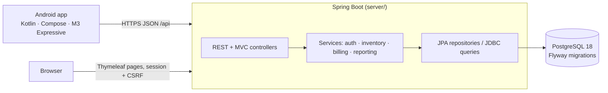

# Architecture

One Spring Boot modular monolith serves both the Android REST API and the Thymeleaf website. Both clients share the same services and database.

## Runtime

| Component | Image / build | Notes |
| --- | --- | --- |
| `db` | `postgres:18-alpine` | Volume `db-data`; bound to `127.0.0.1` only |
| `app` | `server/Dockerfile` (Temurin 21, layered Boot jar, non-root) | Health: `/actuator/health` (`/liveness`, `/readiness`) |

## Checklist

Feature reference and known pitfalls: [reference-audit.md](reference-audit.md).

- [x] Phase 0: audit, repository layout, Gradle build, Compose (app + PostgreSQL), health check, CI
- [ ] Flyway schema: categories, users, products, orders, order items, stock log, discount rules, notifications
- [ ] Safe seed data: synthetic users, hashed passwords
- [ ] Security: browser session + CSRF; Android token auth; per-object ownership checks
- [ ] Catalog: categories, products (partial updates, no field wiping), search/filter
- [ ] Inventory: transactional restock and adjustment with stock log; low-stock and expiry alerts in services
- [ ] Billing: transactional checkout with row locks, merged duplicate lines, validated discounts, configurable tax stored per order
- [ ] Orders and receipts with ownership checks
- [ ] Analytics: daily summary, monthly sales, product and category performance, clearance, expiry
- [ ] Users: admin management, cashier customer lookup and in-place customer registration
- [ ] Parity and concurrency tests (Testcontainers PostgreSQL)
- [ ] Thymeleaf website
- [ ] Android app
