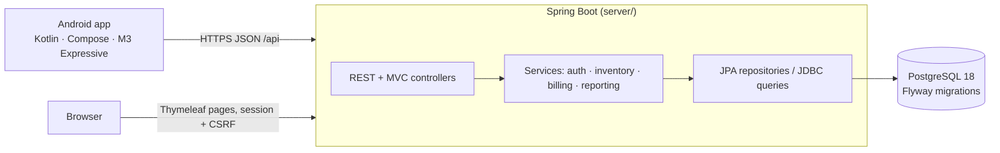

# Architecture

One Spring Boot modular monolith serves both the Android REST API and the Thymeleaf website. Both clients share the same services and database.

## Runtime

| Component | Image / build | Notes |
| --- | --- | --- |
| `db` | `postgres:18-alpine` | Volume `db-data`; bound to `127.0.0.1` only |
| `app` | `server/Dockerfile` (Temurin 21, layered Boot jar, non-root) | Health: `/actuator/health` (`/liveness`, `/readiness`); volume `app-data` for product images |

## Packages (`com.smartstock`)

| Package | Contents |
| --- | --- |
| `common` | Configuration properties (`smartstock.*`), store clock, money rounding, problem-detail errors |
| `security` | Filter chains, JWT issue/verify, current-user resolution |
| `auth` | Users, roles, login, registration, user administration |
| `inventory` | Categories, products, images, stock movements, alerts |
| `billing` | Bill calculation, checkout, orders and receipts, discount rules |
| `reporting` | Dashboard and sales reports (SQL via `JdbcClient`) |

Rule ownership: workflows and side effects (stock movements, alerts, pricing) live in Java services inside one transaction; PostgreSQL enforces invariants (non-negative stock and money, quantities, enumerations, uniqueness, foreign keys). There are no triggers or stored procedures.

Concurrency: checkout and stock changes take `SELECT … FOR UPDATE` row locks (in product id order); product edits use optimistic `@Version` checks so they cannot overwrite stock changed concurrently.

## Checklist

Feature reference and known pitfalls: [reference-audit.md](reference-audit.md).

- [x] Phase 0: audit, repository layout, Gradle build, Compose (app + PostgreSQL), health check, CI
- [x] Flyway schema: categories, users, products, orders, order items, stock movements, discount rules, notifications
- [x] Demo data (`demo` profile): synthetic users, hashed passwords
- [x] API security: bearer tokens, role checks per endpoint, per-object ownership checks
- [x] Browser security: session sign-in with CSRF on every form; the user is reloaded per request, so disabling an account ends its session
- [x] Catalog: categories, products (full replacement, stock only via movements), search/filter, images
- [x] Inventory: transactional restock and adjustment with stock movements; low-stock and expiry alerts in services
- [x] Billing: transactional checkout with row locks, merged duplicate lines, validated discounts, configurable tax stored per order, quotes
- [x] Orders and receipts with ownership checks
- [x] Reports: daily summary, monthly sales, product and category performance, clearance, expiry
- [x] Users: admin management, cashier customer lookup and in-place customer registration
- [x] Integration and concurrency tests (embedded PostgreSQL 18)
- [x] Thymeleaf website: role-aware pages for dashboard, products, categories, till, orders and receipts, alerts, reports, offers and users, calling the same services as the API
- [x] Android app: role-aware Compose screens, encrypted session, server-priced till, signed release APKs
